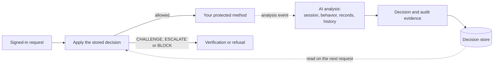

<p align="center">
  
</p>

<p align="center">
  <strong>AI-native runtime security for Spring Boot: decide what a signed-in user may do, request by request.</strong>
</p>

<p align="center">
  <a href="LICENSE"></a>
  <a href="https://central.sonatype.com/artifact/ai.ctxa/spring-boot-starter-contexa"></a>
  <a href="https://openjdk.org/"></a>
  <a href="https://spring.io/projects/spring-boot"></a>
</p>

## What is Contexa?

A login proves who someone is. A role says what they may access. Neither tells you whether the person using the account is its owner doing their own work, or someone who stole the account, or an insider using a legitimate permission for another purpose.

Contexa is an open-source Spring Boot library that closes this gap. For each request to a protected method, it asks an AI model whether the account's owner is doing their own work right now. It weighs the session so far, how the request differs from the user's usual behavior, company records and earlier decisions. It stores the answer as a **decision** and applies it to that user's requests: let them continue, ask for another verification, or stop them.

- **Added to an application you already have.** Your login and your roles stay as they are. Contexa adds one dependency, one annotation and `@Protectable` on the methods to protect.
- **No policy rules to write for the decision.** The AI model chooses the action from the facts of the request; your authorization policies still apply.
- **Not in the request path.** By default the model runs after the response has been sent, so the user does not wait for it; the decision applies from the user's next request. A method can ask for the decision inside the call (`@Protectable(sync = true)`).
- **Explainable.** Every decision is written to a hash-chained, signed audit record, and for a sample of the model's decisions the exact prompt it received is sealed as evidence for later review.
- **Covers AI agents.** Requests from agents are told apart from people's requests and decided separately.

### The same permission, three outcomes

An employee is allowed to read settlement documents. The login and the role are the same in each case:

| What happens | What Contexa weighs | Decision |
|---|---|---|
| Reads the records of an assigned settlement task | Fits the task and the user's recent activity | `ALLOW` |
| Starts opening unrelated customer records | Behavior differs from the user's usual work | `CHALLENGE`: asks for MFA again |
| Keeps going after failing the check | Evidence of continued misuse | `BLOCK`: stopped until an administrator releases it |

The scenario is illustrative: the decision always depends on the context that is supplied, the configured policies, the model's analysis and the enforcement mode.

## The five decisions

| Decision | Meaning | HTTP status | Valid for |
|---|---|---|---|
| `ALLOW` | Continue as usual | 200 | 15 min (`contexa.security.zerotrust.allow-validity`), then back to pending analysis |
| `CHALLENGE` | Step-up authentication (MFA) is required | 401 | 30 min, or until MFA is passed |
| `ESCALATE` | Held for review while the analysis settles | 423 | 5 min |
| `BLOCK` | Refused until an administrator releases it | 403 | Until released |
| `PENDING_ANALYSIS` | No decision stored yet: the request goes on and is analyzed | request passes | Until a decision is stored |

The table shows the behavior when enforcement is on. The stricter decision wins: a weaker new decision is not stored while a stricter one is in force. Agent requests and `@Protectable(sync = true)` calls are decided on the spot and are refused with 503 when no decision can be obtained.

## How it works



The request path only reads the stored decision; it never calls the model. The analysis runs separately, one user session at a time, and the two meet only at the decision store. Analysis is triggered by `@Protectable` calls and by MFA sign-in; an ordinary URL request that is not a protected method is not analyzed. Read [How Contexa Works](https://docs.ctxa.ai/en/docs/reference/architecture/overview.html) for the details.

## Get started

**You need:** Java 17+, Spring Boot **3.5.x** (older versions do not start, and 4.x is not supported), a PostgreSQL database with the pgvector extension that is dedicated to Contexa, and an AI model for chat and for embeddings: a local [Ollama](https://ollama.com), or OpenAI. Anthropic can serve chat, with OpenAI or Ollama for the embeddings.

### Fastest: the CLI

In your Spring Boot project (or an empty folder, which gets a sample application):

```bash
curl -fsSL https://install.ctxa.ai/install.sh | sh      # Windows: irm https://install.ctxa.ai/install.ps1 | iex
contexa init
```

[`contexa init`](https://github.com/contexa-security/contexa-cli) asks which AI model to use, prepares a local PostgreSQL with pgvector and the model, adds the dependencies, `@EnableAISecurity` and the settings to your project, checks that everything resolves, and offers to start the application. `contexa reset` undoes it.

### By hand

**1. Add the dependencies.** The starter brings the five Contexa modules; add Spring Security and the Spring AI model and vector-store starters you use next to it. The starter does not bring Spring Security, so that adding it alone changes nothing in your application.

```gradle
dependencies {
    implementation 'ai.ctxa:spring-boot-starter-contexa:0.1.1'
    implementation 'org.springframework.boot:spring-boot-starter-security'
    implementation platform('org.springframework.ai:spring-ai-bom:1.1.8')
    implementation 'org.springframework.ai:spring-ai-starter-model-ollama'
    implementation 'org.springframework.ai:spring-ai-starter-vector-store-pgvector'
}
```

<details>
<summary>Maven</summary>

```xml
<dependencyManagement>
    <dependencies>
        <dependency>
            <groupId>org.springframework.ai</groupId>
            <artifactId>spring-ai-bom</artifactId>
            <version>1.1.8</version>
            <type>pom</type>
            <scope>import</scope>
        </dependency>
    </dependencies>
</dependencyManagement>
<dependencies>
    <dependency>
        <groupId>ai.ctxa</groupId>
        <artifactId>spring-boot-starter-contexa</artifactId>
        <version>0.1.1</version>
    </dependency>
    <dependency>
        <groupId>org.springframework.boot</groupId>
        <artifactId>spring-boot-starter-security</artifactId>
    </dependency>
    <dependency>
        <groupId>org.springframework.ai</groupId>
        <artifactId>spring-ai-starter-model-ollama</artifactId>
    </dependency>
    <dependency>
        <groupId>org.springframework.ai</groupId>
        <artifactId>spring-ai-starter-vector-store-pgvector</artifactId>
    </dependency>
</dependencies>
```

</details>

**2. Turn Contexa on.** With only the dependency, Contexa stays off and your application runs as before. The annotation turns it on; without a mode your application keeps its own sign-in.

```java
@SpringBootApplication
@EnableAISecurity   // io.contexa.contexacommon.annotation.EnableAISecurity
public class MyApplication {
    public static void main(String[] args) {
        SpringApplication.run(MyApplication.class, args);
    }
}
```

**3. Configure.** Contexa needs a database of its own (it creates its tables there at the first start) and an AI model. Pull the Ollama models first: `ollama pull qwen3:8b` and `ollama pull mxbai-embed-large`.

```yaml
contexa:
  security:
    zerotrust:
      mode: SHADOW             # analyze and record decisions without applying them
  datasource:                  # the dedicated Contexa database, not your application's
    url: jdbc:postgresql://localhost:5432/contexa
    username: contexa
    password: ${CONTEXA_DB_PASSWORD}
  llm:
    selection:
      chat:
        mode: dynamic-priority
        priority: ollama
      embedding:
        mode: fixed
        priority: ollama
    chat:
      ollama:
        base-url: http://127.0.0.1:11434
```

**4. Protect a method.**

```java
@Service
public class OrderService {

    @Protectable   // io.contexa.contexacommon.annotation.Protectable
    public Order getOrder(Long orderId) {
        return orderRepository.findById(orderId).orElseThrow();
    }
}
```

A signed-in user (a Spring `Authentication`) is needed when the method is called. Run the application, call the method as a signed-in user, and look for `[IamSeedData] OSS schema provenance verified.` in the startup log. With Spring Boot Actuator, `GET /actuator/contexacapabilities` shows which parts are ready. Details: [Getting started](https://docs.ctxa.ai/en/get-started.html).

## Choose the modes

Three independent settings decide how Contexa runs:

| Setting | Options | What it decides |
|---|---|---|
| Sign-in ownership | `SANDBOX` (default) / `FULL` | Your application keeps sign-in, or Contexa provides sign-in, MFA and the admin console (`@EnableAISecurity(mode = SecurityMode.FULL)`) |
| Enforcement, `contexa.security.zerotrust.mode` | `SHADOW` / `ENFORCE` (default) / `OBSERVE` / `DISABLED` | `SHADOW` analyzes and records only; `ENFORCE` stores and applies decisions |
| Infrastructure, `contexa.infrastructure.mode` | `standalone` (default) / `distributed` | State in memory of one server, or shared through Redis and Kafka. `distributed` needs a single Redis server or Sentinel: Redis Cluster is not supported in this release. `org.redisson:redisson` brings a JCache provider, so an application whose cache goes through JCache sets its cache, for example `spring.cache.type=caffeine` |

**Start with `SHADOW`.** Watch the decisions for your own scenarios, then switch to `ENFORCE`. See [Start Safely with Enforcement Modes](https://docs.ctxa.ai/en/docs/install/shadow-mode.html).

## Documentation and examples

- **Documentation:** [docs.ctxa.ai](https://docs.ctxa.ai): [Getting started](https://docs.ctxa.ai/en/get-started.html), [How Contexa Works](https://docs.ctxa.ai/en/docs/reference/architecture/overview.html), [Configuration](https://docs.ctxa.ai/en/docs/install/configuration.html), [`@Protectable` reference](https://docs.ctxa.ai/en/docs/reference/iam/protectable.html).

Runnable applications in [contexa-examples](https://github.com/contexa73/contexa-examples), described in the [Examples Guide](https://docs.ctxa.ai/en/docs/install/examples.html):

| Example | What it shows |
|---|---|
| `contexa-example-quickstart` | The smallest setup |
| `contexa-example-protectable` | Four ways to use `@Protectable` |
| `contexa-example-identity-dsl` | The authentication DSL |
| `contexa-example-identity-mfa`, `-mfa-multi` | MFA with custom pages, and two MFA flows |
| `contexa-example-identity-oauth2` | OAuth2 stateless authentication |
| `contexa-example-legacy-system` | Adding Contexa to an existing login |

## Modules

| Module | Responsibility |
|---|---|
| `spring-boot-starter-contexa` | The one dependency an application adds |
| `contexa-autoconfigure` | Spring Boot auto-configuration and wiring |
| `contexa-core` | The decision engine: AI calls, analysis, learning, sealed evidence, audit |
| `contexa-identity` | Sign-in flows, MFA and passkeys, OAuth2, request-time filters |
| `contexa-iam` | Policy-based authorization, `@Protectable`, the admin console |
| `contexa-common` | Decision types, shared annotations, the authentication bridge |

These modules are the open-source runtime. Commercial and enterprise operational features are delivered separately.

## Project

Contexa is at an early stage (`0.1.x`) and licensed under [Apache 2.0](LICENSE).

- **Contribute:** [Contributing guide](CONTRIBUTING.md), [issues](https://github.com/contexa-security/contexa/issues), [maintainers](MAINTAINERS.md), [governance](GOVERNANCE.md), [code of conduct](CODE_OF_CONDUCT.md).
- **Report a vulnerability:** follow [SECURITY.md](SECURITY.md).
- **History:** [Changelog](CHANGELOG.md), [release notes](RELEASE_NOTES.md).
